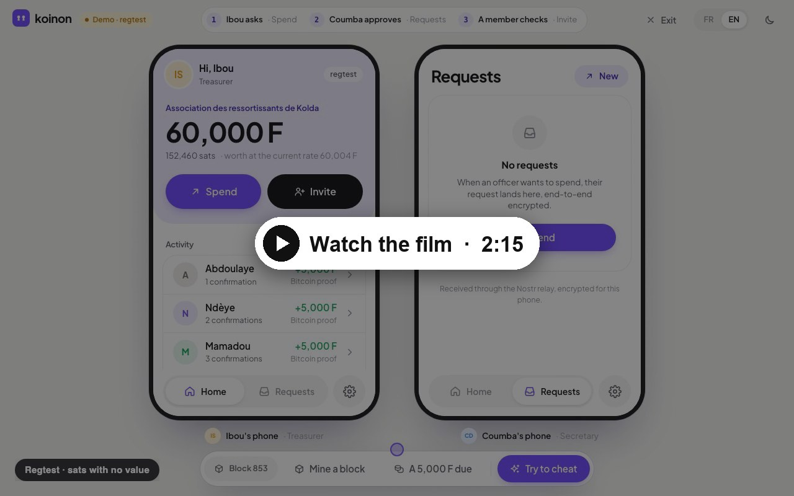
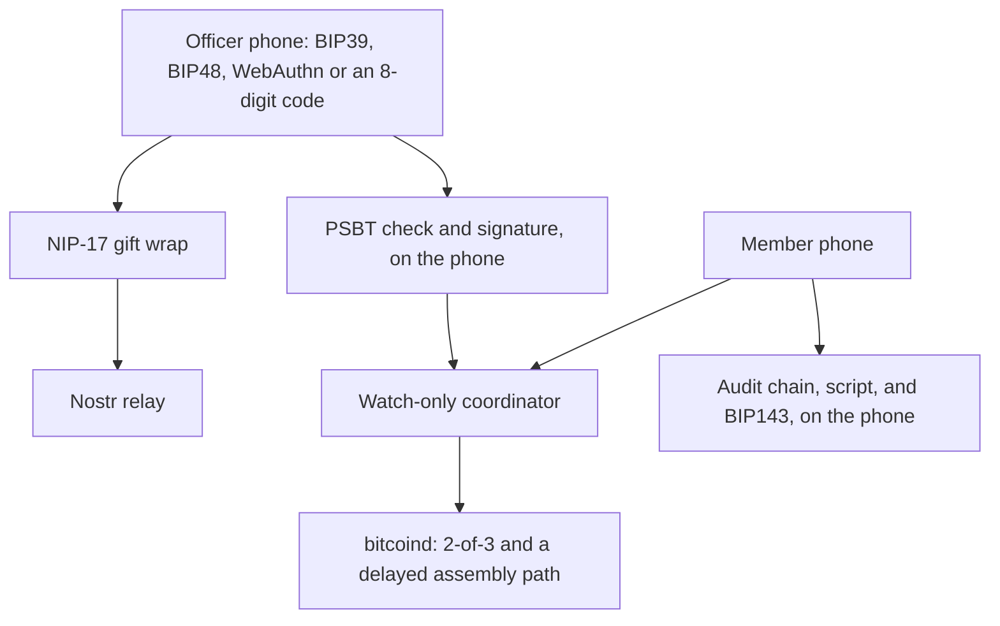
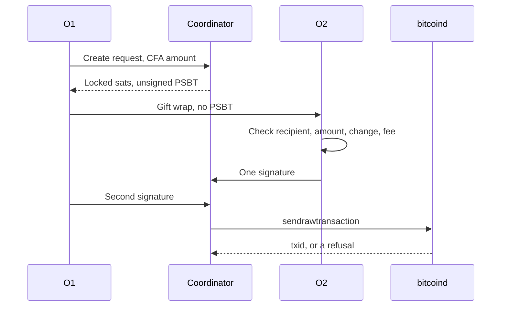

<div align="center">


# Koinon

**The treasurer of a shared fund cannot move the money alone.**

[Site](https://102-68-84-31.sslip.io) · [Watch the film (2:15)](docs/media/koinon-demo.mp4) · [Demo](https://102-68-84-31.sslip.io/app) · [Run it](#getting-started) · [What works today](#status) · [The proof](#evidence) · [Policy](docs/POLICY.md)

<a href="https://102-68-84-31.sslip.io/app"></a>


<a href="LICENSE"></a>

<p align="center">
  <a href="docs/media/koinon-demo.mp4"></a>
</p>

The public demo is one HTTPS origin on a Nigeria VPS: homepage, `/app`, `/v1`, and `/relay` on the same host. The spend rule runs on regtest, Bitcoin Core 32.1. It did not run on mainnet. The film is that demo, recorded locally. It is not a mainnet payment.

</div>

<a id="summary"></a>

## The 60-second summary

Two of three officers must sign, from their own devices, before a satoshi leaves the fund. The rule is a Bitcoin script. A one-signature transaction is refused by bitcoind, not by a screen. Spend requests travel as encrypted Nostr messages. Members read contributions and spends in CFA francs. The server holds no private key.

On 17 Nov 2026, 1,000 XOF locked at 2,541 sats. The euro price in that run was a fixture of 60,000, not a market price. One signature was rejected. Two signatures were accepted.

| What was measured | Result | Where |
| --- | --- | --- |
| 1 officer signature | bitcoind refused it, `NULLFAIL` | `pnpm kill-test`, regtest |
| 2 officer signatures | accepted, 1 confirmation | tx `9f9144009c779907d8048f34a336dea3398251b595ee2846d6a502f127aa1728` |
| Path B before 10 blocks | bitcoind refused it, `non-BIP68-final` | same command |
| Path B after 10 blocks | accepted, 1 confirmation | tx `318088820b2e9e0e1f52565c21f733d3e96f88375804bbdd6ae5632d0ad880d9` |
| 1,000 XOF at the fixture | 2,541 sats, then a confirmed spend | `pnpm e2e`, tx `ccc8f9dd877540679e3db141754cb374a65c71416e12e8c25863fd0a0acc2865` |

> **The script is the guard.** The coordinator can build a transaction. It cannot make bitcoind accept one signature, and an officer's own check refuses a transaction that no longer matches the request.

| What has been observed | Where the boundary is |
| --- | --- |
| bitcoind rejected 1 signature and accepted 2 | Local regtest, Bitcoin Core 32.1, not mainnet |
| bitcoind rejected path B, then accepted it after 10 blocks | `N` is 10 on regtest. A real fund would set about 4,320 blocks. That setting was not used |
| A swapped recipient was refused before any signature | The officer's function. The coordinator is not trusted for this check |
| 12 members, a confirmed spend, an expired request, and a broken audit row | `pnpm e2e` on the host. Docker Compose was not started on this machine |
| Gift-wrapped request and approval | Loopback relay. It does not authenticate publishers. No public relay |
| A member phone can recompute the audit chain and a spend's signatures from the raw transaction | `@noble/hashes` and `@noble/curves` in the browser. It does not run bitcoind's script flags, and it does not count blocks |

The phone is a Bitcoin wallet. It derives BIP39 keys on `m/48'/1'/0'/2'`, builds the P2WSH 2-of-3 plus CSV script, checks the PSBT, and signs. The coordinator never receives the mnemonic. There is no Lightning wallet here. A Lightning node that receives for the fund would hold the pot. This fund is meant to sit for months in a script nobody holds.

| Devpost criterion | What to look at | Limit |
| --- | --- | --- |
| Usefulness and local impact | A dahira, a GIE, or a club whose treasurer can empty the Wave account today. The member link shows the pot in francs. | Zero associations are using it. The rows below are targets, not traction. |
| Security by design | bitcoind refuses one signature. The officer's phone refuses a swapped recipient. The member's phone checks the witness. | Regtest. No audit. Two officers who agree can spend. |
| UX and UI on a slow phone | `/` and `/fonds/:id` do not load the signing code. The measured times are in [Evidence](#evidence). | One headless Chromium on this Mac, not a handset and not the VPS. |
| Working MVP | [Live demo](https://102-68-84-31.sslip.io/app), `pnpm e2e`, or Compose from [docs/DEPLOY.md](docs/DEPLOY.md). | Regtest faucet. Not mainnet. |
| Clear pitch and docs | This page, [docs/POLICY.md](docs/POLICY.md), [docs/THREAT_MODEL.md](docs/THREAT_MODEL.md). | Team names are not in the repo. The license is MIT. |

The rubric is on [the Devpost page](https://dakar-bitcoin-hack-2026.devpost.com/). This table is a map to that page. It is not a score. The paste-ready write-up and the demo shot list are in [docs/SUBMISSION.md](docs/SUBMISSION.md).

| Pilot metric | Now | Target, not a result |
| --- | --- | --- |
| Associations onboarded | 0 | First conversations with dahiras, GIEs, and clubs that already collect a monthly pot |
| Median time from request to the second signature | not measured | Same day |
| Tampered or one-signature attempts blocked | the regtest refusals in the table above | Every one the phone or bitcoind actually sees |
| Member links opened with a matching fingerprint | not measured outside this demo | The link that ends with `#`, checked on the phone |

**Everything here runs on regtest. Those sats have no value.** A live price from mempool.space was requested once and timed out. The server returned `RATE_UNAVAILABLE` and did not invent a price.

The film is [Watch the film (2:15)](docs/media/koinon-demo.mp4). It was recorded 18 Nov 2026 from this app. The voice is a neural draft, not a person. The shot list is [docs/VIDEO.md](docs/VIDEO.md).

<a id="looks"></a>

## What the demo looks like

The homepage says "Nobody empties the fund alone." Main button: "Try the demo."

- Ibou taps Sign and send on 15,000 F. Coumba sees recipient, amount, and locked rate, then Approve. After one block: "Paid. The transaction is in a block."
- A swapped payee stops before signing: `PSBT_MISMATCH`, "the transaction does not pay the requested recipient."
- Invite link for WhatsApp. No account and no key. The sheet says "Checked on this phone from Bitcoin bytes, not from the server's database," and names Ibou + Coumba only when the link fingerprint matches.
- French and English switch in the header. Playwright passed at 390×844 (39.2s) and 360×740 (39.8s), headless Chromium on this Mac, not a handset.
- Signing code loads only on `/app` (370,383 bytes). `/` was 109,054 bytes, `/fonds/:id` 140,460, unknown fund. `/` not measured again.

Live: HostAfrica, Nigeria, one HTTPS origin, `/v1/health` ok on 18 Nov 2026.

<a id="demo"></a>

## Demo

**One URL for judges, Devpost, and this README** — same origin for the pitch and the working app:

| Page | Link |
| --- | --- |
| Homepage | [https://102-68-84-31.sslip.io/](https://102-68-84-31.sslip.io/) |
| Two-phone demo | [https://102-68-84-31.sslip.io/app](https://102-68-84-31.sslip.io/app) |

Caddy serves the built `apps/web` static files and proxies `/v1` and `/relay` to the coordinator stack in Docker on that VPS. Passkeys and the Nostr websocket are bound to this hostname. Do not send judges to a second host (for example a static-only deploy) for the interactive demo.

Health check: [`GET /v1/health`](https://102-68-84-31.sslip.io/v1/health) should return `{"ok":true,...}`.

The CLI is still the proof that bitcoind refused one signature.

**Five minutes, no Docker.** Bitcoin Core 32.1 on the path, Node 22, pnpm 11.1.2.

```bash
pnpm install
pnpm e2e
```

You should see a checklist of `[x]` lines: 12 members, 2,541 sats locked, `PSBT_MISMATCH`, bitcoind's one-signature refusal, a confirmed spend, `REQUEST_EXPIRED`, `non-BIP68-final`, then a recovery after 10 blocks, then an audit that fails after one row is changed. The first lines say the rate is a fixture, not a market price.

If Docker is missing, the script prints that and uses the host node. That is the run that exists. `docker compose up --build` is written in `infra/docker-compose.yml` and has not been executed here.

**No bitcoind.** This does not move money. It does refuse a swapped recipient, and it adds no signature:

```bash
pnpm tamper-test
```

```text
ALLOW honest: fee 1000 change 9000 signed true
REFUSE tampered recipient: PSBT_MISMATCH
signed after refusal: false
```

<a id="contents"></a>

## Contents

1. [The problem](#problem)
2. [The rule](#rule)
3. [Who it is for](#who)
4. [How it works](#how)
5. [What this does not claim](#claims)
6. [Evidence](#evidence)
7. [Decisions](#decisions)
8. [Stack](#stack)
9. [CLI](#cli)
10. [Getting started](#getting-started)
11. [Repo map](#repo)
12. [What works today](#status)
13. [Next](#next)

<a id="problem"></a>

## 1. The problem

A dahira, a GIE, or a sports club in Senegal keeps a shared pot. The treasurer often holds the Wave account. One person can empty it. The argument afterwards is about a balance nobody else can reconstruct.

Multisig already exists. [Liana](https://github.com/wizardsardine/liana), [Nunchuk](https://nunchuk.io/), and [Sparrow](https://sparrowwallet.com/) already do shared keys and timelocks, and they do that job better than this repo as wallets. Koinon is the association workflow around that rule: a CFA ledger, a request an officer can read on their own device, and a recovery path the assembly cannot use early.

No association is using this. The runs below are regtest.

<a id="rule"></a>

## 2. The rule

> **Two officers, or nobody spends.** One officer plus the assembly key spends only after N blocks. The server never holds a key.

- **The script refuses a lone treasurer.** Path A is 2 of 3. The proof is bitcoind's rejection, in [docs/POLICY.md](docs/POLICY.md).
- **The officer refuses a changed payment.** Recipient, amount, change back to the fund, fee cap, and fund inputs are checked before a signature exists. Code: `PSBT_MISMATCH` or `FEE_OVER_CAP`.
- **Recovery waits.** Path B is one officer plus the assembly key, after `OP_CHECKSEQUENCEVERIFY`. Early, bitcoind says `non-BIP68-final`.
- **The CFA figure is frozen when the request is created.** Sats are rounded up so the recipient is not short. A later price does not move that request. If there is no price, the spend is refused.
- **The request is a private message.** NIP-17 gift wrap. The message has no PSBT. The fee cap stays on the officer's machine.

<a id="who"></a>

## 3. Who it is for

| Who | What changes | Where this repo shows it |
| --- | --- | --- |
| Treasurer (O1) | Cannot broadcast alone. Opens a request for an exact CFA amount. | `pnpm e2e`, one signature refused |
| Second officer (O2 or O3) | Signs on their own device, or refuses. One officer can veto. | `attack tamper`, `approve`, `reject` |
| Member | Sees each contribution and spend in XOF. Holds no key. | `status` after `mine` |
| Assembly key (K) | Spends only with one officer, and only after N blocks. Cannot open a normal spend. | `recover` before and after `mine 10` |

Hypothesis, not a measurement: one group has a treasurer who can empty the pot today. Ten such groups would be ten treasurers who cannot. This repository has onboarded zero groups. No city-wide count is used here.

Metrics a pilot would track, and that this repo has not measured: funds onboarded, spends per month, median time from request to the second signature, and requests refused for a mismatch. The measured stand-in is the regtest checklist, not a pilot.

### The problem, sourced

These numbers are why a shared pot is a real object in Senegal. None of them is a count of theft, a count of dahiras, or a Koinon user. The homepage draws the same figures, with the same limits. Read on 18 Nov 2026.

| Figure | What it counts | What it does not count | Source |
| --- | --- | --- | --- |
| 425 of 1,000 cases (42.5%) answered yes | Senegal, Global Findex 2025 microdata, survey year 2024. Question fin17c: saved in the past 12 months using an informal savings group or club, or a person outside the family. | A population estimate. The file says the case counts are not summary statistics of the population. The question is wider than a tontine. | [World Bank microdata, fin17c](https://microdata.worldbank.org/catalog/7971/variable/F1/V64?name=fin17c) |
| Women 57.4%, adults 43.5%, men 28.3%. 2014: 28.6% | EFA Études' weighting of that Findex file, published 23 Oct 2026. Senegal, adults 15 and over. | The unweighted 42.5%. A gap under 3 points is not significant in a survey of about 1,000. The page does not publish the years between 2014 and 2024, and says one jump is not a trend. | [EFA, La tontine en chiffres](https://efa.africa/etude-tontine-en-chiffres) |
| Senegal 24.1% of UEMOA e-money transaction volume in 2024 (22.7% in 2023). Value share 30.2% (29.9% in 2023). Volume up 24.79% | BCEAO, annual report on digital financial services in the UEMOA for 2024, file dated March 2026. §59 is volume, §60 is value, §34 is the growth. The same report's union total is 11 billion transactions and 160,415 billion CFA francs. The other 2024 shares in §59: Côte d'Ivoire 21.4%, Benin 21.4%, Burkina Faso 18.2%, Mali 10.7%, Togo 3.2%, Guinea-Bissau 0.7%, Niger 0.6%. | Money held by associations. An e-money account still has one holder. Another BCEAO document gives a different union value; it is not blended here. | [BCEAO PDF](https://www.bceao.int/sites/default/files/2026-03/Rapport%20annuel%20sur%20les%20services%20financiers%20num%C3%A9riques%20dans%20l%27UEMOA%20-%202024.pdf) |
| More than 2,500 solidarity funds, more than 80,000 members, 95% women, 13 regions | Minister Alioune Dione, National Solidarity Fund day in Thiès, reported by APS on 19 Feb 2025. Members pool a fund and make interest-free loans. | A census of tontines or GIEs. Not evidence that a treasurer stole. The APS page returned 404 when fetched on 18 Nov 2026; the same dispatch is on Leral. | [Leral, carrying APS, 19 Feb 2025](https://www.leral.net/Plus-de-2-500-calebasses-de-solidarite-denombrees-a-travers-le-pays_a377683.html) |
| 6,869 / 6,674 / 6,857 GIE registrations in 2022 / 2023 / 2024 | APIX national RCCM table, row "Immatriculation GIE". Registrations that year. | The stock of GIEs. The same page's APIX-office row is a different count: 1,314 / 1,208 / 1,071. A 2025 column is on the page (6,594 national, 949 at the office). The page does not say that year is complete, so it is left off the chart. | [APIX, création d'entreprise](https://investinsenegal.sn/services/creation-dentreprise/) |

### What this is not

A shared Wave or Orange Money account. A server that can approve a spend. Lightning, a hold invoice, or a node that receives the pot. An assistant, or a Wolof interface. Mainnet, or an audit. A defence against two officers who agree to sign. The longer table is [What this does not claim](#claims).

<a id="how"></a>

## 4. How it works

| Part | What it does | Code |
| --- | --- | --- |
| Policy | Builds the witness script and the PSBT. Does not trust the server. | [packages/core](packages/core) |
| Coordinator | Watch-only. Members, ledger, requests, audit. No private key. | [apps/coordinator](apps/coordinator) |
| Nostr | Gift-wraps the request and the approval. | [packages/nostr](packages/nostr) |
| CLI | The demo. French by default, `--lang en`. | [apps/cli](apps/cli) |
| Regtest | bitcoind. The thing that accepts or refuses. | [scripts/regtest.ts](scripts/regtest.ts) |

<p align="center">
  <a href="docs/diagrams/koinon-architecture.excalidraw"></a>
  <br/><sub>The big picture. Source: <a href="docs/diagrams/koinon-architecture.excalidraw"><code>docs/diagrams/koinon-architecture.excalidraw</code></a> (open it at excalidraw.com). The same path, as a sequence, is below. Regtest. Sats have no value. About 4,320 blocks was not used.</sub>
</p>



The member does not sign. The relay carries the request, not the authority to spend. The coordinator can hand the phone a raw transaction. It cannot make a bad signature verify. bitcoind accepts the transaction or it does not. The CLI follows the same path without the screen.



> [!IMPORTANT]
> A displayed balance is not a spend. Status stays pending until two signatures exist, broadcast until bitcoind accepts the transaction, and confirmed only after the indexer sees it in a block.

<a id="claims"></a>

## 5. What this does not claim

| Claim | Because | Limit |
| --- | --- | --- |
| One officer cannot spend | bitcoind rejected the one-signature witness | Two officers who agree can spend. That is the rule. |
| An officer does not sign a swapped payment | `verifySpend` throws before `signVerifiedSpend` adds a signature | The officer must run that check. A patched client can ignore it. The script still requires two keys. |
| Recovery cannot happen early | bitcoind returned `non-BIP68-final` | Only for the `N` the fund was created with. Regtest uses 10. |
| The server has no key | Keys are encrypted on the officer's machine. The process has no key file. | Fund creation and member add are unauthenticated. The fund id is the capability. Money still needs two signatures. |
| Logs omit the person | The e2e scan found no pseudonym, seed word, `xprv`, `nsec1`, pin, or PSBT | CI also scans every container log from the compose run (`scripts/log-scan.sh`). It checks fixed patterns and two adjacent words of one seed, not every word of every seed. One word alone is not a hit. |
| The CFA amount is the one they approved | Sats and the rate are stored on the request | The euro input was a fixture of 60,000, or a test double of the same number. Not a live market price. |
| A 5,000 F due is not eaten by the fee | At the 60,000 EUR fixture, 5,000 F is 12,705 sats. A P2WPKH→P2WSH landing is ~122 vbytes. At 2 sat/vB that is 244 sats, 96 F, paid by the member's wallet, not subtracted from the due. At 5 sat/vB, 240 F. | This is an association treasury, not a 500 F weekly tontine. A spend of one 2-of-3 input with change, at 2 sat/vB, is 600 sats (236 F) from `estimateVbytes(1, 2)` in `packages/core/src/coinselect.ts`. |

Not claimed: mainnet, an audit, Lightning, Mobile Money, a spend a judge can broadcast from Vercel, collusion protection, a public Nostr relay, or publisher authentication on the demo relay. Docker Compose has run only on GitHub Actions ([run 44156940764](https://github.com/datharnu/koinon/actions/runs/44156940764), all nine checks and the container log scan passed), not as a public host.

Review: none. No third party has read this. The severities in [docs/THREAT_MODEL.md](docs/THREAT_MODEL.md) are the author's.

The price feed is mempool.space when `MEMPOOL_PRICES_URL` is left at the default. This machine did not get an answer. The demo points that URL at a fixture. A missing price is a refusal, not a guessed rate.

<a id="evidence"></a>

## 6. Evidence

Recorded 17 Nov 2026 on this machine. Bitcoin Core 32.1. Long output is in [docs/DEFERRED.md](docs/DEFERRED.md) and [docs/POLICY.md](docs/POLICY.md). Regtest txids are not on a public explorer.

| Command | What it showed |
| --- | --- |
| `pnpm kill-test` | 1 signature refused. 2 signatures accepted, tx `9f9144009c779907d8048f34a336dea3398251b595ee2846d6a502f127aa1728`. Path B refused, then accepted after 10 blocks, tx `318088820b2e9e0e1f52565c21f733d3e96f88375804bbdd6ae5632d0ad880d9`. |
| `pnpm tamper-test` | Swapped recipient, `PSBT_MISMATCH`, no signature added. No bitcoind. |
| `pnpm coordinator-spend` | Live price timed out, `RATE_UNAVAILABLE`. A labeled test double then spent. tx `057ec038f9356186151ab9fc7498e1541c9ec00c7e76a879d90ed3f8eb980bda`. |
| `pnpm nostr-test` | Gift wrap delivered. Ciphertext had no purpose. Tamper produced no approval. |
| `pnpm cli-demo` | The officer path, a veto, and recovery. Recovery tx `6c1ccaa39387ef08ccdfcdd1547fd4c877594e430b23db9d21d3d4d298ab68f7`. |
| `pnpm e2e` | Re-run the same day, host bitcoind, Docker not installed. 10 checks passed. 1,000 XOF locked at 2,541 sats. Spend tx `cccd0cc38c17c5ff889f9e58402c04f492cfca8827dd2fe3d46a618b13651bbd`. Recovery tx `5a6995f9f959071643c74e1820b68d812841621bba8e5623a30b99174c1a37bf`. An earlier run the same day: spend `ccc8f9dd877540679e3db141754cb374a65c71416e12e8c25863fd0a0acc2865`, recovery `7f50d10e467ee5ccb5342c6de9cbb863c9a817d410cb7a39ee448ef150037cc1`. |
| `pnpm test` | After the member-proof cases: core 30, coordinator 10, nostr 2. They do not start bitcoind. Earlier the same day: core 22, coordinator 2, nostr 2. At the script proof: 7. |
| `pnpm ui-walk` | Playwright, one worker, against `http://localhost:5173` and the host coordinator. 390×844 passed in 39.2s. 360×740 passed in 39.8s. 2 passed. The fund was created with an 8-digit code. |

`pnpm test` earlier the same day, at the script proof, was 7. That count is kept in [docs/POLICY.md](docs/POLICY.md). The later count does not erase it.

GitHub Actions: [run 44156940764](https://github.com/datharnu/koinon/actions/runs/44156940764). Unit tests and the compose e2e passed. The live site is the web build, not that run. That run does not include the member-proof tests added after it.

`pnpm build:web` on this machine, Vite 8.3.8, then one cold load in headless Chromium. Cache off. Latency 400 ms. Download and upload 400 × 1024 / 8 bytes per second. CPU throttle 4. Viewport 390×844. The server was `vite preview` on `127.0.0.1:4173`. This is not a phone and not a VPS. Time is until the route's own text was on screen. Transfer is `transferSize`, which includes headers.

| Route | Visible | Transfer | What loaded |
| --- | --- | --- | --- |
| `/` | 3,839 ms | 109,054 bytes | Entry, home, avatar, CSS. No signing code. |
| `/fonds/:id` | 4,249 ms | 140,460 bytes | Those, plus the proof chunk. No signing code. The fund id was unknown, so the screen was "Fund not found". |
| `/app` | 8,781 ms | 370,383 bytes | Those, plus the signing chunk. Its last byte was at 8,586 ms. |

Vite's own gzip line for the signing chunk, `pinpad-BoxGhd4s.js`, was 730.43 kB raw, 227.98 kB gzip. The proof chunk, `phone-z1fi-Luk.js`, was 114.90 kB raw, 39.26 kB gzip. An earlier build the same day was 708 kB raw, 228 kB gzip, and that file loaded on `/fonds` as well. It no longer does. The font files in that transfer were Plus Jakarta (Latin 27.34 kB, Latin extended 21.72 kB, Vietnamese 8.35 kB). They were not in the transfer above at the moment the text appeared. The `/` row is that homepage. The landing page was redesigned twice and mobile language controls were added after this run; `/` has not been measured again. Its chunk is now `Home-Dw-LUIpZ.js` (27.34 kB / 9.09 kB gzip, down from 52.86 / 16.51 for the previous version), plus one hero capture of `/app` in WebP (38.6–43.1 kB, one file per language and theme, only one loads). `/fonds/:id` and `/app` still share the same build structure; the signing chunk is now `pinpad-BUhpHEL4.js` (730.53 kB / 227.99 kB gzip). The script is `scripts/measure-web.mjs`. One run each. A few milliseconds of noise is expected if this is run again.

<!-- TODO: first commit hash, once the repo has one. -->

<a id="decisions"></a>

## 7. Decisions

<details>
<summary><strong>The first 2-of-3 was rejected, and the fix stayed visible.</strong></summary>

CHECKMULTISIG pops the later signature first. The first witness stacked the earlier signature on top, so bitcoind returned the same NULLFAIL as a one-signature spend. The one-signature refusal on that run was already correct. The order was fixed in `packages/core/src/witness.ts` on 17 Nov 2026. The comment records the old order. [docs/DEFERRED.md](docs/DEFERRED.md) still starts with that failure.

</details>

<details>
<summary><strong>The miniscript compiler is used. Its satisfier is not.</strong></summary>

The expression repeats the officer keys, so the compiler reports the script unsane and the satisfier will not build a witness. The script bytes still come from the compiler. The witness is built in this repo and checked by bitcoind. A second script implementation was the alternative, and it was not taken.

</details>

<details>
<summary><strong>No price is hardcoded.</strong></summary>

`pnpm coordinator-spend` asked mempool.space. The request timed out. The server returned `RATE_UNAVAILABLE`. The rest of that run, and `pnpm e2e`, used 60,000 EUR only after printing that the number was a fixture or a test double. A fallback constant inside the coordinator was the alternative, and it was not added.

</details>

<details>
<summary><strong>The coordinator does not tell the officer where change goes.</strong></summary>

The signer re-derives the fund scripts from the xpubs stored on the device. A change output to any other address is `PSBT_MISMATCH`. Trusting a change address in the server response was the shorter path, and it was not taken.

</details>

<a id="stack"></a>

## 8. Stack

| Layer | Choice | Why |
| --- | --- | --- |
| Script and PSBT | `bitcoinjs-lib` 7.0.5, `@bitcoinerlab/miniscript` 2.0.1 | The compiler produces the script. bitcoind is the acceptance test. |
| Keys | BIP48, testnet coin type `1'`, even on regtest | `m/48'/1'/0'/2'/change/index`. One receive index per member. |
| Node | 22, from `.nvmrc` | `node:sqlite` is the database. It is experimental. |
| Coordinator | Fastify 5 | Watch-only HTTP. Writes are rate-limited in memory, per process. |
| Messages | `nostr-tools` 2.26.1, NIP-17 | The request is not a PSBT on the relay. |
| Chain | Bitcoin Core 32.1, regtest | The refusal has to come from the node. |
| Web | Vite 8, React 19, Tailwind 4 | The wallet UI. Keys, the P2WSH script, the PSBT check, and the signature stay in the browser. The member view checks the raw transaction with `@noble/curves`. |
| Package manager | pnpm 11.1.2 | Workspaces. There is no npm script runner beyond what pnpm exposes. |

<a id="cli"></a>

## 9. CLI

French by default. `--lang en` switches the sentences. The pin is `--pin` or `KOINON_PIN`, at least 8 characters. It is not sent to the coordinator. The CLI does not print a seed, an `nsec`, or a PSBT.

```bash
pnpm koinon init-fund --name "Dahira Démo" --csv 10 --fee-cap 100000
pnpm koinon member add membre-01
pnpm koinon contribute membre-01 5000
pnpm koinon mine 1
pnpm koinon status
pnpm koinon request 1000 bcrt1q... fournitures --as O1
pnpm koinon attack tamper <request-id> --as O2
pnpm koinon attack single-sig <request-id> --as O1
pnpm koinon approve <request-id> --as O1
pnpm koinon approve <request-id> --as O2
pnpm koinon broadcast <request-id>
pnpm koinon mine 1
pnpm koinon recover bcrt1q... --as O3
pnpm koinon audit verify
```

`attack single-sig` exits 0 when bitcoind refuses. It exits 1 if bitcoind accepts. `recover` before N prints the refusal and exits 0. That refusal is the result.

Roles are labels, not names: O1 treasurer, O2 secretary, O3 president, K assembly. Full HTTP detail is [docs/API.md](docs/API.md). The screen is `apps/web`, live at [102-68-84-31.sslip.io](https://102-68-84-31.sslip.io). The contract it follows is [docs/UI_CONTRACT.md](docs/UI_CONTRACT.md).

<a id="getting-started"></a>

## 10. Getting started

You need a local regtest node for any command that moves or refuses a transaction. `pnpm test` and `pnpm tamper-test` do not need one.

| Tool | Version | Check |
| --- | --- | --- |
| Node | 22, `.nvmrc` says `22` | `node -v` |
| pnpm | 11.1.2 | `pnpm -v` |
| Bitcoin Core | 32.1, the version this proof used | `bitcoind -version` |
| Docker | not used in the run that exists | `docker compose version` |

```bash
pnpm install
pnpm test
pnpm tamper-test
```

`pnpm test` prints the vitest counts and does not start bitcoind. `pnpm tamper-test` prints the three lines in the demo section.

With bitcoind installed as `bitcoind` on the path:

```bash
pnpm e2e
```

The first line, when Docker is absent, is `NOTE: docker compose is not installed.` The checklist follows. Regtest sats have no value. The rate line says the figure is a fixture.

The intended one-command stack, not executed on this machine:

```bash
docker compose -f infra/docker-compose.yml up --build
docker compose -f infra/docker-compose.yml --profile e2e run --rm e2e
docker compose -f infra/docker-compose.yml down -v
```

Compose publishes the coordinator on `127.0.0.1:8787` and the relay on `127.0.0.1:8080`. It does not publish Bitcoin RPC. A CLI command that mines or spends, once that stack exists, is:

```bash
docker compose -f infra/docker-compose.yml --profile tools run --rm cli status
```

<!-- TODO: verify the compose commands. They have not been run. -->

| Variable | Required | Example | What it does |
| --- | --- | --- | --- |
| `PORT` | no | `8787` | Coordinator port. |
| `HOST` | no | `127.0.0.1` | Bind address. Compose sets `0.0.0.0` inside the container. |
| `KOINON_DB` | no | `data/koinon.sqlite` | SQLite file. `:memory:` is tests. |
| `BITCOIN_RPC_URL` | for spends | `http://127.0.0.1:18445` | Host node. Not published by compose. |
| `BITCOIN_RPC_USER` | for spends | `koinon` | Local regtest user. Not a mainnet secret. |
| `BITCOIN_RPC_PASSWORD` | for spends | `koinon` | Local regtest password. Not a mainnet secret. |
| `BITCOIN_RPC_WALLET` | for the CLI | `bootstrap` | Wallet name for mine and contribute. |
| `MEMPOOL_PRICES_URL` | no | mempool.space prices | EUR source. No hardcoded fallback. |
| `KOINON_HOME` | for the CLI | `.koinon` | Encrypted keys and public config. |
| `KOINON_PIN` | for the CLI | 8 characters or more | Decrypts keys. Never sent to the coordinator. |
| `KOINON_COORDINATOR` | for the CLI | `http://127.0.0.1:8787` | Watch-only API. |
| `KOINON_RELAY` | for requests | `ws://127.0.0.1:8080` | Gift-wrap relay. |
| `LOG_LEVEL` | no | `info` | Coordinator logs. Bodies are redacted. |

`FIXTURE_EUR` and `KOINON_RATE_SOURCE` belong to the demo price process. The coordinator does not read them. The full list is [.env.example](.env.example). None of these are browser-public variables. The frontend talks to `/v1` and `/relay` on the same origin; Vercel has neither.

| Command | Covers |
| --- | --- |
| `pnpm test` | Policy, CFA rounding, signer refusals, key encryption, coordinator API, Nostr. No bitcoind. |
| `pnpm typecheck` | core, coordinator, nostr, CLI, web. |
| `pnpm kill-test` | 1 signature, 2 signatures, path B early, path B late. Starts bitcoind. |
| `pnpm tamper-test` | Swapped recipient, no signature. |
| `pnpm coordinator-spend` | HTTP spend against bitcoind. Live price if it answers. |
| `pnpm nostr-test` | Gift wrap on a loopback relay. |
| `pnpm cli-demo` | CLI path, including veto and recovery. |
| `pnpm e2e` | 12 members and the judge checklist. |
| `pnpm seed` | Fund, 12 members, contributions. Needs a coordinator that is already up. |

> [!NOTE]
> `ExperimentalWarning: SQLite is an experimental feature` is expected. It is Node's warning for `node:sqlite`.

> [!WARNING]
> `RATE_UNAVAILABLE` means the price URL did not answer and nothing was cached. Do not put a constant in the coordinator to get past it. Point `MEMPOOL_PRICES_URL` at a fixture, or wait for the network, and say which one you used.

> [!TIP]
> A one-signature refusal that contains `Signature must be zero` is the guard working. `attack single-sig` exits 0 on that line.

> [!TIP]
> If port 18445 is already taken, stop the other regtest. `pnpm e2e` and `pnpm kill-test` both use it and both wipe `.regtest`.

<a id="repo"></a>

## 11. Repo map

| Path | Responsibility |
| --- | --- |
| [packages/core](packages/core) | Script, keys, PSBT, CFA, signer check, key encryption. |
| [packages/nostr](packages/nostr) | Message schemas, gift wrap, the demo relay. |
| [apps/coordinator](apps/coordinator) | HTTP, chain scan, ledger, audit. |
| [apps/cli](apps/cli) | Demo commands. |
| [apps/web](apps/web) | Homepage and two-phone demo. Live on Vercel as static files. |
| [scripts](scripts) | Regtest, kill test, seed, e2e, log scan. |
| [infra](infra) | Compose file. Run in CI. Not a public host. |
| [docs](docs) | Policy, API, threat model, UI contract, the run log. |

<a id="status"></a>

## 12. What works today

<details open>
<summary><strong>Observed</strong></summary>

| What | Evidence |
| --- | --- |
| 1 signature refused, 2 accepted | `pnpm kill-test`, 17 Nov 2026, Bitcoin Core 32.1 |
| Path B refused, then accepted after 10 blocks | same command, both txids in the table above |
| Signer refuses a swapped recipient, a wrong amount, foreign change, a fee over the cap, a foreign input | `pnpm test` in core, and `pnpm tamper-test` |
| Coordinator spend, veto path, audit tamper | `pnpm coordinator-spend` and `pnpm e2e` |
| Gift wrap hides the purpose | `pnpm nostr-test` and `pnpm e2e` |
| Keys encrypted, absent from the file and the transcript | `pnpm cli-demo` |
| 12 members and the full checklist | `pnpm e2e` |
| Public demo on one origin | [102-68-84-31.sslip.io](https://102-68-84-31.sslip.io/), `/app`, `/v1/health` ok, 18 Nov 2026. Compose on HostAfrica VPS, Nigeria. |

</details>

<details>
<summary><strong>Built, not observed</strong></summary>

- A restarted coordinator reading the same database.
- Two machines, or a public relay.
- A pin typed at a prompt. The demo passes `--pin`.
- A live mempool price. The one attempt timed out.
- Path B broadcast through the coordinator's HTTP API. The coordinator refuses an immature coin before it builds the PSBT. Recovery in the CLI talks to bitcoind directly, and that path was observed.

</details>

<details>
<summary><strong>Deliberately absent</strong></summary>

- Lightning, mainnet, Banxaas, Mobile Money, AI, Wolof, phone numbers, push notifications.
- Collusion protection beyond 2 of 3.
- A hardcoded bitcoin price.
- Publisher authentication on the demo relay.

</details>

<details>
<summary><strong>Open</strong></summary>

- Coin selection is greedy, largest first. It can overpay the fee. It will not cross the fee cap.
- The rate limit is in memory, per process, and resets on restart.
- `node:sqlite` is experimental.
- Creating a fund and adding a member are unauthenticated. The fund id is unguessable. The money still needs two signatures.
- The demo relay accepts any publisher.
- The license is MIT, in [LICENSE](LICENSE). Copyright 2026 Koinon contributors. Names are not in this repo until they are supplied.
- The Devpost criteria are mapped in the summary. The page is [dakar-bitcoin-hack-2026.devpost.com](https://dakar-bitcoin-hack-2026.devpost.com/).

</details>

<a id="next"></a>

## 13. Next

1. Put the compose stack on one domain, as [docs/DEPLOY.md](docs/DEPLOY.md). Vercel cannot proxy `/v1` or the relay socket, and a passkey belongs to one domain.
2. A real price response from mempool.space, shown next to the fixture so the two are not confused.
3. `N` at about 4,320 blocks on a network where that wait means something. Not before the 10-block proof is boring.
4. A third-party reading of the script. Then, and only then, a conversation about mainnet.
5. Lightning stays out. A node that receives into a channel holds the coins on that node. The rule in this repo is a script that can hold an association's pot for months, where neither the treasurer nor the server can move it alone.
6. An assistant stays out. It would talk about a spend. It would not be the thing that refuses one.
7. A Mobile Money bridge, including the kind of cash-in Banxaas does, stays out until the script is the thing a pilot trusts. The bridge would sit in front of the fund. It would not replace the two signatures.

<div align="center">

Koinon. The treasurer cannot move the money alone.

[Back to the top](#summary)

</div>
